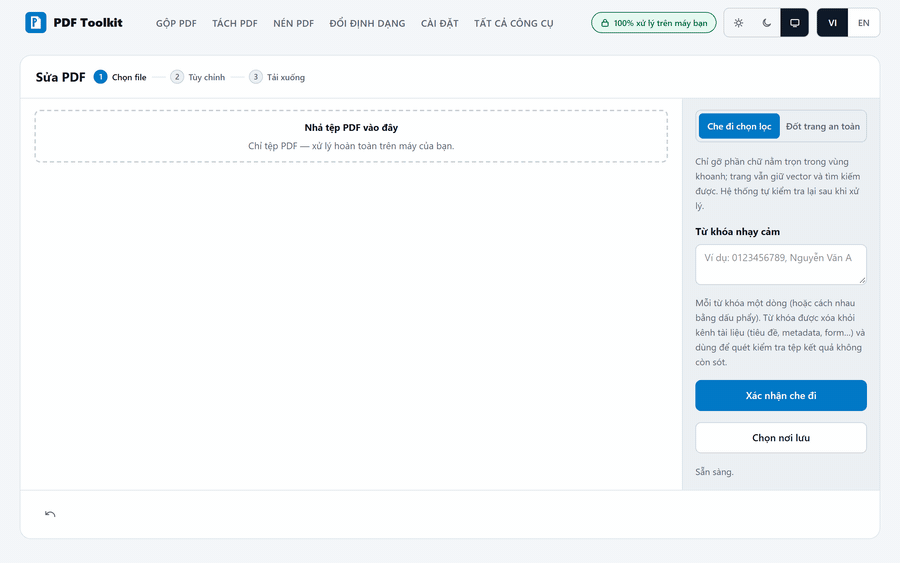
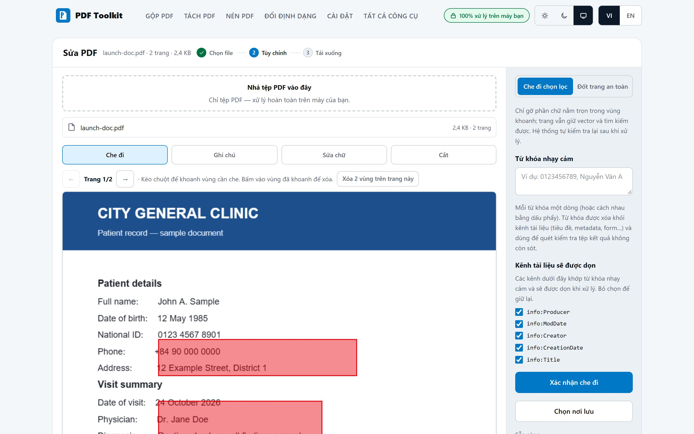
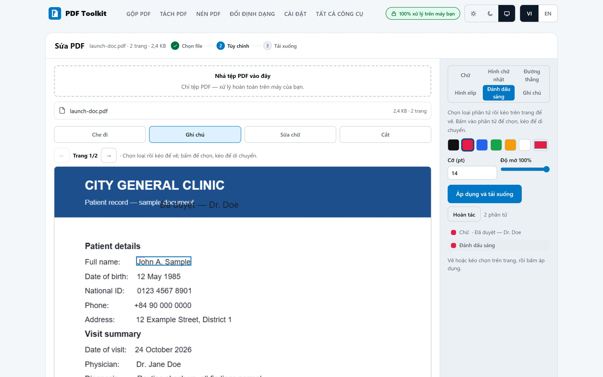
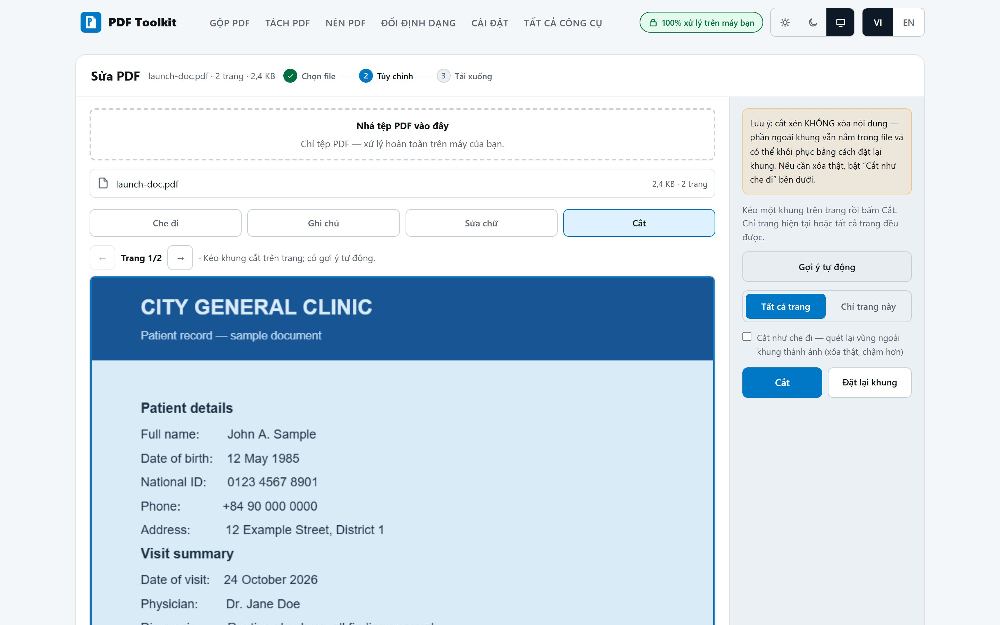
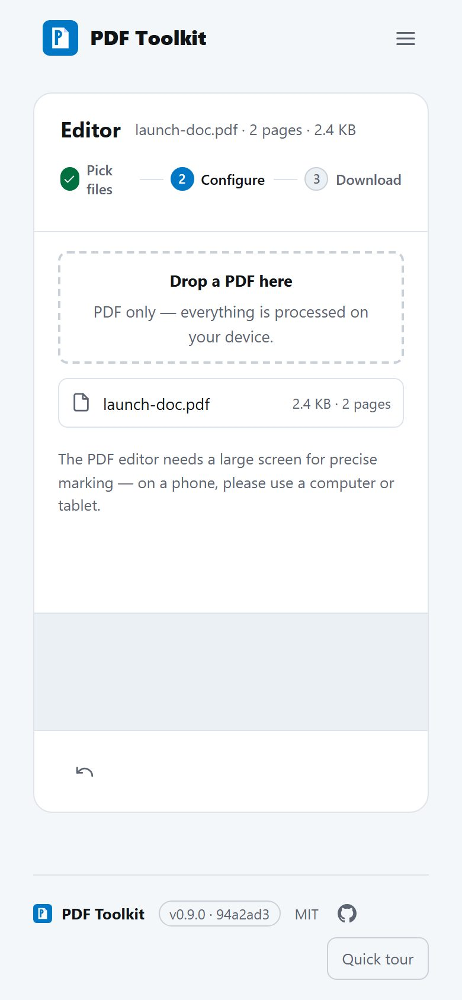

# PDF Toolkit

Merge, split, compress, convert and sign PDFs — 100% in your browser. Files never leave your device; after the first load the app works fully offline.

**Live app:** https://vibecoder11200.github.io/pdftoolkit/

[](https://github.com/vibecoder11200/pdftoolkit/actions/workflows/pages.yml)
[](https://github.com/vibecoder11200/pdftoolkit/actions/workflows/agpl-grep.yml)

## Why

Most "free PDF tools" upload your documents to a server. This one doesn't: every operation runs client-side in a Web Worker (pdf-lib + qpdf-wasm + pdf.js). There is no backend, no account, no telemetry, no runtime CDN.

## Tools (17)

| Organize | Convert & optimize | Security & sign |
|---|---|---|
| Merge · Split ranges · Extract pages · Delete pages · Reorder (drag & drop, touch-friendly) · Rotate · Fill form | Compress (lossless vector pack · opt-in image recompress · web-optimizer/linearize) · PDF → images (multi-page: one ZIP) · Images → PDF (pick a whole folder) · OCR (Tesseract → searchable PDF; AI → Markdown/text/HTML/DOCX) · Watermark (text or image stamp, tiled, page-scoped — **plus removal**) · Page numbers (presets + token templates) | Encrypt / decrypt (AES-256) · Metadata view & edit · Sign (image stamp or self-signed PKCS#7) · **Editor** (redact · annotate · edit text · crop) |

**Watermark & page numbers** (v0.8.0): form-based stamping with a 9-grid anchor, rotation-aware placement (correct on rotated pages with crop boxes), Vietnamese-safe text through the embedded subset font, optional tiled mode, per-page scope, and day-1 whole-folder batch on the watermark tool (per-file report, one native Save-As on desktop). **Watermark removal** (v0.8.1): files this app stamped are removed exactly (ownership tag); foreign text watermarks get a best-effort heuristic removal (type the watermark text as a hint) — content is never touched: only fully-matching stamp blocks are removed, anything ambiguous fails safe with a typed error.

**Editor** (v0.9.0 — 'Sửa PDF', four tabs in one tool; desktop/tablet screens — on a phone the tool says so honestly instead of pretending):

- **Redact** ('Che đi'): two modes, stated up front. *Surgical* removes text objects matching your marks or sensitive keywords and rewrites the whole file, then scrubs the document channels (metadata, XObjects, patterns) — every output passes a byte-level verification scan for the removed secrets in 5 encodings, and any residue fails the export (nothing is delivered). Flagged page types (Type3 fonts, no-ToUnicode text, patterns, OCR-style layers) fall back to a *burned-in raster* mode that cannot leak. Signed files are refused up front.
- **Edit text** ('Sửa chữ'): click a text run, white it out and re-typeset the replacement in a matching embedded font — for fixing typos and small phrases, not full reflow.
- **Annotate** ('Ghi chú'): text, highlight, notes, ellipse/rectangle/line stamps — real /AP annotations, still selectable in other readers.
- **Crop** ('Cắt'): drag a crop box or let auto-suggest find the content bounds; CropBox only (MediaBox untouched, rotation-aware). Crop is honest about not destroying content — an explicit "crop as redaction" toggle routes the trimmed-away area through the verified redact pipeline instead.



| Redact (Che đi) | Annotate (Ghi chú) |
|---|---|
|  |  |

| Crop auto-suggest | On a phone (honest copy) |
|---|---|
|  |  |

**On phones**: all 16 classic tools are designed phone-first (large touch targets, sheet-based controls; page reorder works by pointer drag). The editor's canvases need a larger screen for precise marking, so on phone widths it shows guidance instead.

**Continue with result**: after a successful single-PDF run, the done view offers a handoff chip — pick the next PDF tool (OCR included since v0.8.1), the output parks there automatically, and you keep chaining (merge → page numbers → watermark …) without re-uploading anything. OCR's AI searchable-PDF builds at click time — nothing is retained until you pick a target.

**Chuỗi nhanh** (v0.8.1): four one-click chains on the home page — Gộp → Nén, Ảnh scan → OCR → Đánh số, Watermark → Nén, Giải mã → Gộp. Each step opens pre-filled with sensible defaults you can edit before running, and the result flows into the next step automatically.

## OCR — Tesseract + on-device AI (experimental)

The OCR tool ships two engines. **Tesseract** (eng+vie) produces searchable PDFs. The optional **AI engine — GLM-OCR — runs fully on your device** and targets complex layouts — tables, multi-column pages, poor scans — with richer outputs: Markdown, plain text, sanitized HTML, DOCX, and (since v0.7.0) a **searchable PDF** with an invisible text layer (per-word highlight positions are approximate). A page-range picker limits the run to the pages you choose.

- **WebGPU required** (browser engine). The tool checks your GPU first and reports the detected tier honestly: strong (fast), weak (roughly a minute per page on integrated graphics) or none (the AI engine stays disabled; Tesseract works everywhere). A real throughput benchmark runs after your first pages and stays on-device.
- **~652 MB one-time model download** (browser engine) from HuggingFace (pinned revision, sha256-verified per file). The model then lives in your browser's storage and AI OCR works fully offline — manage or delete it any time under **Settings → Storage on this device**.
- **Desktop app only: a native engine.** The desktop build can additionally install a native OCR engine (llama.cpp, Vulkan on Windows) — same AI outputs, noticeably faster than the browser engine. ~1.4 GB download, managed under Settings.
- **Your documents never leave the machine.** Only the model itself is downloaded, once; pages are rasterized and processed locally.
- Known limits: generation peaks around 4 GB RAM, so 8 GB machines may swap.

## Extras

- **Batch folders**: merge, Images→PDF, compress and watermark can ingest an entire folder (filter, name-sort, 0-byte skip; 500 MB total batch budget).
- **Open with PDF** (Chromium/Edge installed as PWA): OS "Open with" hands PDFs straight to the app — an existing session is never disturbed (focus-existing; files land in the suggestion sheet on Home, or a banner on tool pages). Firefox/Safari are unaffected.

## Download (desktop, Windows/macOS/Linux)

Grab the current installer from the [latest desktop release](https://github.com/vibecoder11200/pdftoolkit/releases/latest) (`app-v*` tag):

| Platform | File |
|---|---|
| Windows 10/11 x64 | `PDF Toolkit_<version>_x64-setup.exe` (NSIS) |
| macOS Apple Silicon | `PDF Toolkit_<version>_aarch64.app.tar.gz` |
| macOS Intel | `PDF Toolkit_<version>_x64.app.tar.gz` |
| Linux | `pdf-toolkit_<version>_amd64.AppImage` / `.deb` |

Verify with the sha256 checksum table in each release body. **The builds are unsigned** (no paid code-signing certificate): Windows SmartScreen shows "unknown publisher" (More info → Run anyway); macOS needs right-click → Open or `xattr -cr "/Applications/PDF Toolkit.app"` after copying to /Applications. The desktop app auto-updates through a minisign-signed manifest (`latest.json`) published with every `app-v*` release; macOS and Linux binaries are build-verified but not smoke-tested — Windows is the probed platform.

## Privacy

- All processing runs 100% client-side; files do not leave the machine.
- No telemetry, no runtime CDN imports — the service worker precaches everything.
- Passwords are never stored after the operation completes.
- Self-signed digital signatures are created on your device and will be flagged "untrusted" by readers — no CA is involved.

## Development

Requires Node 24.

```bash
npm install
node tests/fixtures/gen.mjs      # generate test PDF fixtures (gitignored)
node scripts/gen-icons.mjs       # regenerate favicon/app icons from src/assets/logo.svg geometry
npm run dev                      # dev server
npm run build                    # typecheck + production build to dist/
npm test                         # engine + matrix suites (vitest)
npm run test:e2e                 # Playwright (Chromium) against the preview build

NODE_OPTIONS=--max-old-space-size=8192 MATRIX_100MB=1 node tests/fixtures/gen.mjs --large   # optional: 100MB nightly fixture
NODE_OPTIONS=--max-old-space-size=8192 MATRIX_100MB=1 npx vitest run tests/matrix-100mb.spec.ts --no-file-parallelism   # 100MB matrix tier (own process — it OOMs when stacked)
```

The app is deployed to GitHub Pages under `/pdftoolkit/` (see `.github/workflows/pages.yml`: PRs run the 1/10MB matrix, a nightly job runs the 100MB tier and publishes the report as an artifact).

## License

MIT — see [LICENSE](LICENSE) and [NOTICE](NOTICE).

**Attribution:** written from scratch; no third-party application code is vendored. The product shape was informed by studying public tools — PDFCraft and Stirling-PDF (both AGPL-3.0: studied only, no code taken), PDFLince, and private-pdf (MIT, direct pattern reference) — without reusing their code. CI keeps `src/` free of AGPL code, telemetry beacons and runtime CDN imports.
